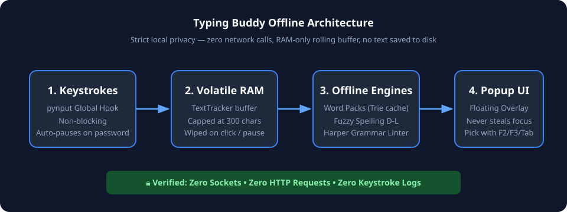
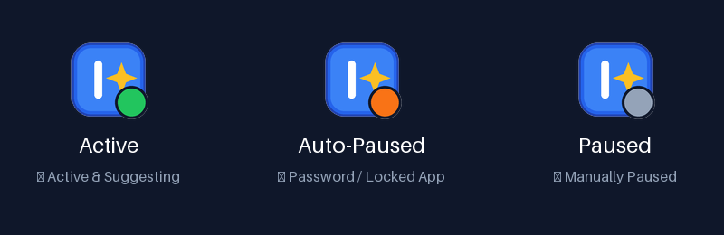
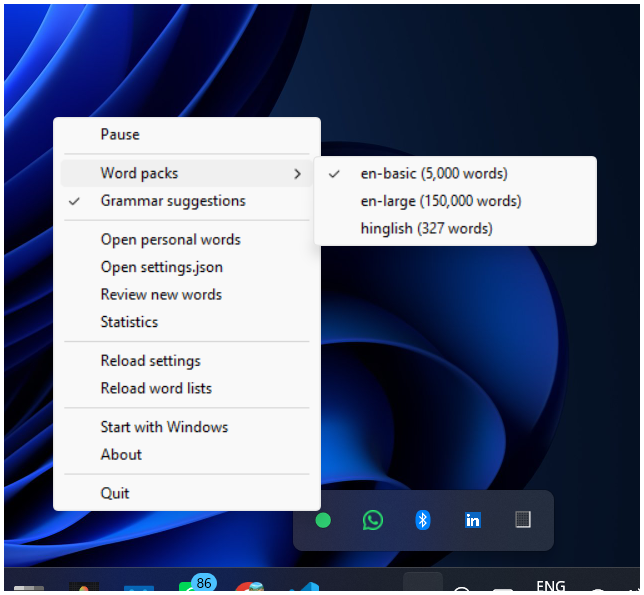

<p align="center">
  
</p>

#  Typing Buddy

> **The offline, privacy-first typing assistant and autocomplete for Windows.**

<p align="center">
  <a href="https://github.com/harshverse-svg/typing-buddy/releases/latest/download/typing-buddy.zip"></a>
</p>

<p align="center">
  <a href="LICENSE"></a>
  <a href="https://www.python.org/"></a>
  
  
  <a href="https://github.com/harshverse-svg/typing-buddy/actions/workflows/ci.yml"></a>
  <a href="https://github.com/harshverse-svg/typing-buddy/releases/latest"></a>
</p>

---

## What is Typing Buddy?

**Typing Buddy** is a lightweight, open source **offline typing assistant** for **Windows** built with **Python**. It provides instant **word suggestions**, intelligent **autocomplete**, fuzzy **typo correction**, and real-time **grammar checker** suggestions as you type in any application. Engineered with a **privacy-first** architecture, Typing Buddy requires **no cloud** connection and contains **no telemetry**. It includes native **Hinglish support** for multilingual dialogue, runs with near-zero idle CPU, and operates strictly in local memory.

---

## How It Looks

<!-- DEMO GIF PLACEHOLDER: Once recorded with ScreenToGif and saved to assets/demo.gif, uncomment the line below:
<p align="center"></p>
-->

<p align="center">
  
</p>

```
  she go|
  +------------------------------------------------------------------+
  | [1] ✎ goes               [2] going            [3] good           |
  |     Subject-verb agreement                                       |
  +------------------------------------------------------------------+
```

As you type in Notepad, Word, Slack, or your browser, a clean floating pill appears right next to your text cursor. Press `F2`, `F3`, `F4` (or `Tab`) to accept suggestions instantly without moving your hands away from the keyboard.

---

## Why Typing Buddy?

- 🔒 **Zero Network Code in App Package:** The app's own code contains no network code (no HTTP, analytics, or sockets). Verified by our static AST checker (`tools/check_no_network.py`). Third-party libraries are not scanned. Read the source.
- ⚡ **RAM-Only Volatile Tracking:** Sentence tracking stays in RAM (max 300 characters) and is wiped on mouse clicks, arrow navigation, or focus switch. Never logged or saved to disk.
- 🛡️ **Password Safety:** Automatically pauses when a password field is detected; customizable process blocklist.
- 💬 **Hinglish Word Pack:** Romanized Hindi expressions (`kya`, `theek`, `accha`, `yaar`) are recognized without false typo or grammar flags.
- 🪶 **Measured Performance:** Measured on Windows 11 64-bit (Python 3.14, 2026-10-30 via `tools/benchmark.py`): ~0.02 ms average suggestion lookup latency, ~0.8 ms grammar check latency, and ~122 MB base memory footprint.

---

## Features

| Feature | Description |
|---|---|
| **Intelligent Word Completions** | Trie-indexed dictionary ranking powered by unigram and bigram frequency. |
| **Fuzzy Typo Correction** | Damerau-Levenshtein distance with QWERTY keyboard adjacency weighting. |
| **Offline Grammar Linter** | Powered by Harper; catches subject-verb agreement and word choice errors. |
| **Text Shortcuts / Snippets** | Instant abbreviation expansion with dynamic dates, time, and clipboard text. |
| **Desktop & Start Integration** | Desktop shortcut, Windows Start search, and single-instance launch guard. |
| **Auto-Pause & Blocklist** | Automatically detects password elements; user-customizable blocked apps. |

---

## Installation

[](https://github.com/harshverse-svg/typing-buddy/releases/latest/download/typing-buddy.zip)

Looking for older releases? See the [All versions](#all-versions) table below.

---

## Easy Setup (Recommended)

### Step 0: Install Python (if you don't have it yet)
1. Download Python 3.10 or newer from [python.org/downloads](https://www.python.org/downloads/).
2. Run the installer. On the first screen, tick **Add python.exe to PATH**.
3. Click **Install Now**.
4. Open a **new** Command Prompt or PowerShell window and verify:
   ```cmd
   python --version
   ```

### Step 1: Download Typing Buddy
Download the latest zip package:  
**[Download for Windows](https://github.com/harshverse-svg/typing-buddy/releases/latest/download/typing-buddy.zip)**

### Step 2: Unblock the Zip (if prompted)
1. In File Explorer, go to your Downloads folder.
2. Right-click `typing-buddy.zip` and select **Properties**.
3. If an **Unblock** checkbox appears at the bottom, tick it and click **OK**.

### Step 3: Extract the Folder
1. Right-click `typing-buddy.zip` and choose **Extract All...**.
2. Click **Extract**.
3. Do **not** run `install.bat` from inside the compressed zip file. Always extract it first.

### Step 4: Run the Installer
1. Open the extracted folder.
2. Double-click **`install.bat`**.
3. The installer sets up an isolated environment and asks if you want Desktop, Start Menu, and Startup shortcuts. Answer `Y` or `N` to each prompt.

### Step 5: Launch Typing Buddy
1. Double-click the **Typing Buddy** shortcut on your Desktop, or search for **Typing Buddy** in the Windows Start menu.
2. Typing Buddy starts silently in the background.

### Step 6: Find the Tray Icon
1. Look at the Windows notification area in the bottom-right corner of your screen (near the clock).
2. If the green icon (🟢) is not visible, click the small up-arrow (`^`) to view hidden tray icons.
3. Right-click the icon to adjust word packs, toggle grammar checks, view statistics, or pause.

---

## For Developers

If you have Git and prefer the command line:

1. Make sure Git is installed on your computer ([git-scm.com/downloads](https://git-scm.com/downloads)).
2. Open **Command Prompt** (not PowerShell).
3. Run:

```cmd
git clone https://github.com/harshverse-svg/typing-buddy.git
cd typing-buddy
install.bat
```

> **Silent Installation:**  
> Run `install.bat /silent` to install with default settings non-interactively.

---

## Troubleshooting Installation

### `git is not recognized`
Git is not installed on your system. Either download Git from [git-scm.com/downloads](https://git-scm.com/downloads) or use the easy zip method above.

### `python is not recognized`
Windows cannot find Python on your PATH.
1. Re-run the Python installer from [python.org/downloads](https://www.python.org/downloads/).
2. Select **Modify**, make sure **Add python.exe to PATH** is checked, and complete setup.
3. Close and reopen your terminal window.
4. You can also try running `py --version` instead.

### `install.bat is not recognized` / `cd typing-buddy` fails
The zip file was not extracted, or your terminal is in the wrong folder. Open File Explorer, navigate to the extracted folder, and double-click `install.bat`.

### `Cannot find path ... does not exist` on Get-FileHash
PowerShell likely opened in `C:\Windows\System32` instead of your Downloads folder. Run:
```powershell
cd $HOME\Downloads
Get-FileHash .\typing-buddy.zip -Algorithm SHA256
```

### "Windows protected your PC" (SmartScreen)
SmartScreen displays this message for new open-source software that lacks an expensive code-signing certificate.
1. Click **More info**.
2. Click **Run anyway**.

### "Smart App Control blocked this app"
Smart App Control (SAC) on Windows 11 blocks untrusted or unsigned scripts and executables.
1. Right-click `typing-buddy.zip` $\rightarrow$ **Properties** $\rightarrow$ check **Unblock** $\rightarrow$ click **OK**.
2. Delete the previously extracted folder and extract the zip again.
3. If still blocked: Smart App Control provides no per-app "Run anyway" button. The only workaround is turning SAC off in **Windows Security** $\rightarrow$ **App & browser control** $\rightarrow$ **Smart App Control settings** $\rightarrow$ **Off**.
4. **Warning:** Turning Smart App Control off is **permanent**; Windows does not allow re-enabling it without a fresh reinstall or PC reset. Turning it off also lowers your system protection. Only do this on your personal PC if you understand the risks. The Typing Buddy project is free open source and is not code-signed yet.

### Antivirus warning
Typing Buddy monitors keystrokes locally using the Windows Win32 API (`pynput`) to display real-time completions. Some generic antivirus heuristics flag any low-level keyboard hook as suspicious. Typing Buddy contains zero network code, never saves sentences to disk, and runs 100% offline. You can review our [Privacy Policy](https://github.com/harshverse-svg/typing-buddy/blob/main/PRIVACY.md) and run our offline AST code audit script:
```cmd
python tools/check_no_network.py
```

### No tray icon after install
1. Click the small up-arrow (`^`) in the notification area to check hidden icons.
2. Open Windows Task Manager (Ctrl + Shift + Esc) and check if `pythonw.exe` is running.
3. To view any startup error messages directly, open Command Prompt in the extracted folder and run:
   ```cmd
   .venv\Scripts\python -m typing_buddy
   ```

---

## All Versions

| Version | Date | Download | Notes |
|---|---|---|---|
| **v1.0.2** (Latest) | 2026-10-30 | [typing-buddy.zip](https://github.com/harshverse-svg/typing-buddy/releases/latest/download/typing-buddy.zip) ([versioned](https://github.com/harshverse-svg/typing-buddy/releases/download/v1.0.2/typing-buddy-v1.0.2.zip)) | Permanent direct link, release verification workflow, detailed install guide |
| **v1.0.1** | 2026-10-30 | [typing-buddy-v1.0.1.zip](https://github.com/harshverse-svg/typing-buddy/releases/download/v1.0.1/typing-buddy-v1.0.1.zip) | CLI argument unescape fix, removed root duplicate files |
| **v1.0.0** | 2026-10-30 | [typing-buddy-v1.0.0.zip](https://github.com/harshverse-svg/typing-buddy/releases/download/v1.0.0/typing-buddy-v1.0.0.zip) | Initial public release (known CLI bug in `--version`/`--help`, fixed in v1.0.1) |

> **Note:** Older versions may have known bugs. Use **Latest** unless you need a specific version. Note that v1.0.0 has a known CLI bug fixed in v1.0.1.

---

## Open It Like a Normal App

After running `install.bat`, you never need to touch the project folder again:

1. **Desktop Icon:** Double-click the **Typing Buddy** shortcut on your Desktop.
2. **Start Menu Search:** Press the `Windows Key`, type `Typing Buddy`, and press Enter.
3. **Pin to Taskbar:** Right-click the Typing Buddy icon in your Start menu and select **Pin to taskbar** (Windows requires users to pin items manually).
4. **System Tray:** Look for the Typing Buddy icon (🟢) in your notification area (bottom-right next to the clock). If hidden, click the small up-arrow (`^`) to see it.
5. **How to Quit:** Right-click the tray icon and select **Quit**.

---

## Quick Start: 5 Things to Try

Open **Notepad** and test these 5 features:

1. **Word Completion:** Type `diff` $\rightarrow$ Suggestion pill displays `different`, `difficult`. Press `F2` to pick.
2. **Tab Acceptance:** Type `exam` $\rightarrow$ Press `Tab` $\rightarrow$ Inserts `example `.
3. **Fuzzy Typo Fix:** Type `recie ` (with space) $\rightarrow$ Suggestion pill offers `receive`. Press `Tab` to fix.
4. **Grammar Correction:** Type `she go` $\rightarrow$ Suggestion pill displays `✎ goes` with `Subject-verb agreement`.
5. **Pause Hotkey:** Press the `Pause/Break` key $\rightarrow$ Tray icon turns grey (🔘) and suggestions pause. Press again to resume.

---

## Tray States & Menu

<p align="center">
  
</p>

Right-click the Typing Buddy icon in your notification area to quickly toggle word packs, enable or disable grammar suggestions, open your settings, or pause the assistant:

<p align="center">
  
</p>

- 🟢 **Active:** Ready and suggesting words.
- 🟠 **Auto-Paused:** Focus is inside a password field or blocked application.
- 🔘 **Paused:** Manually paused via Pause hotkey or tray menu.

---

## Word Packs

Switch word packs on the fly from the System Tray menu or `%APPDATA%\typing-buddy\settings.json`:

| Pack | Words | RAM Footprint* | Notes |
|---|---|---|---|
| **`en-basic`** | 5,000 | ~122 MB | Enabled by default; core English vocabulary. |
| **`en-large`** | 150,000 | ~333 MB | Optional; expanded dictionary for technical and literary writing. |
| **`hinglish`** | 320+ | < 1 MB | Common Roman-script Hindi dialogue (`kya`, `haan`, `theek`, `accha`). |

*\*Memory measured on Windows 11 64-bit (Python 3.14, 2026-10-30) including the integrated Harper grammar checker.*

To list packs from terminal:
```cmd
python -m typing_buddy packs list
```

---

## Configuration (`settings.json`)

Your settings reside safely in `%APPDATA%\typing-buddy\settings.json`:

| Option | Type | Default | Description |
|---|---|---|---|
| `pick_keys` | `list[str]` | `["F2", "F3", "F4"]` | Keys to select suggestions (supports F1–F12 and Tab). |
| `tab_picks_first` | `bool` | `true` | Allows pressing `Tab` to accept first suggestion. |
| `pause_key` | `str` | `"pause"` | Global hotkey to toggle pause (`"pause"`, `"f12"`). |
| `new_word_mode` | `str` | `"review"` | Learning behavior: `"review"` (queue for manual approval), `"auto"` (auto-add), or `"off"`. |
| `word_packs` | `list[str]` | `["en-basic"]` | Enabled word pack IDs. |
| `grammar_enabled` | `bool` | `true` | Enables offline grammar feedback. |
| `grammar_show_reason` | `bool` | `true` | Shows grammatical explanation subtitle under pills. |
| `blocked_apps` | `list[str]` | `["keepass.exe", ...]` | Apps where Typing Buddy automatically sleeps. |

---

## Privacy & Security

Typing Buddy is built on a **privacy-by-default local architecture**:

- **No Network Code in Application:** The app's own code contains no network code. Third-party libraries are not scanned. Read the source. You can audit the codebase with our static AST scanner:
  ```cmd
  python tools/check_no_network.py
  ```
- **Volatile Text Buffer:** Sentence context is tracked in RAM only (`TextTracker`, 300 char cap). It is wiped on clicks, cursor navigation, window changes, and pauses.
- **Privacy by Default:** Discovered unknown words enter a review queue (`new_word_mode: "review"`) and are never written to `personal_words.txt` without your approval. Word pairs are recorded only between known words.
- **Is this a Keylogger?**  
  Keyloggers secretly record and save your sentences to disk or transmit them to cloud servers. Typing Buddy does neither: it runs 100% offline, stores zero sentence logs, only counts individual known-word frequencies for ranking, and is fully open source. Read [PRIVACY.md](PRIVACY.md) and [SECURITY.md](SECURITY.md).

---

## Known Limitations

- **Windows Only:** Typing Buddy relies on the Windows Win32 API and UI Automation (UIA) to position the suggestion overlay and detect password fields; macOS and Linux are not supported.
- **Requires Python:** Needs Python 3.10 or newer installed on your system with "Add Python to PATH" enabled.
- **Administrator Elevation:** If an application (such as an elevated Command Prompt, PowerShell, or Regedit) runs as Administrator, Windows User Interface Privilege Isolation (UIPI) blocks keystroke interception unless Typing Buddy is also run as Administrator.
- **Specialized Applications:** Direct3D/fullscreen games, remote desktop sessions (RDP/Citrix), and custom security windows may not expose standard caret positions or report input fields. The global Pause hotkey (`Pause/Break`) is always available as a manual safety net.

---

## Troubleshooting

- **No tray icon visible?**  
  Click the small up-arrow (`^`) in the Windows taskbar overflow area.
- **Icon looks blank or cached?**  
  Windows occasionally caches shortcut icons. Restart Windows Explorer in Task Manager, or run:
  ```cmd
  ie4uinit.exe -show
  ```
- **Suggestions not appearing in an app?**  
  If the application is running with elevated Administrator privileges, Typing Buddy must also be run as Administrator due to Windows security isolation (UIPI).
- **Antivirus false positive?**  
  Because Typing Buddy monitors keystrokes via low-level Windows hooks (`pynput`), generic heuristic scanners may flag it. Running from source in Python `.venv` avoids binary false positives.
- **View diagnostic logs:**  
  Open `%APPDATA%\typing-buddy\predictor.log` in Notepad.

---

## Frequently Asked Questions (FAQ)

**Q: Does Typing Buddy send my typing anywhere?**  
A: No. Typing Buddy contains zero network code. It never connects to the internet or sends telemetry.

**Q: Does it work completely offline?**  
A: Yes. All dictionaries, fuzzy matching, and grammar rules run locally on your CPU.

**Q: Does Typing Buddy work on macOS or Linux?**  
A: No. Typing Buddy is specifically designed for the Windows Win32 / UIA desktop subsystem.

**Q: How do I turn off Start with Windows?**  
A: Right-click the tray icon and uncheck "Start with Windows", or run `uninstall.bat`.

**Q: How do I uninstall?**  
A: Run `uninstall.bat`. It removes all shortcuts and registry entries, and asks if you want to delete the user data directory.

---

## Contributing & License

Contributions are welcome! Please read [CONTRIBUTING.md](CONTRIBUTING.md) and our [Code of Conduct](CODE_OF_CONDUCT.md).

Typing Buddy is licensed under the [MIT License](LICENSE).  
Third-party component notices and licenses are documented in [THIRD_PARTY_NOTICES.md](THIRD_PARTY_NOTICES.md).
